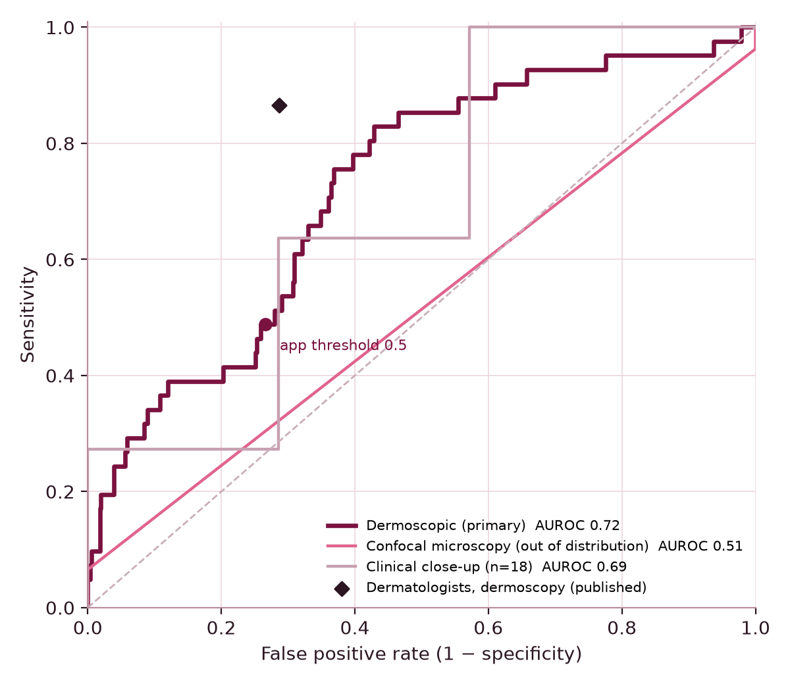
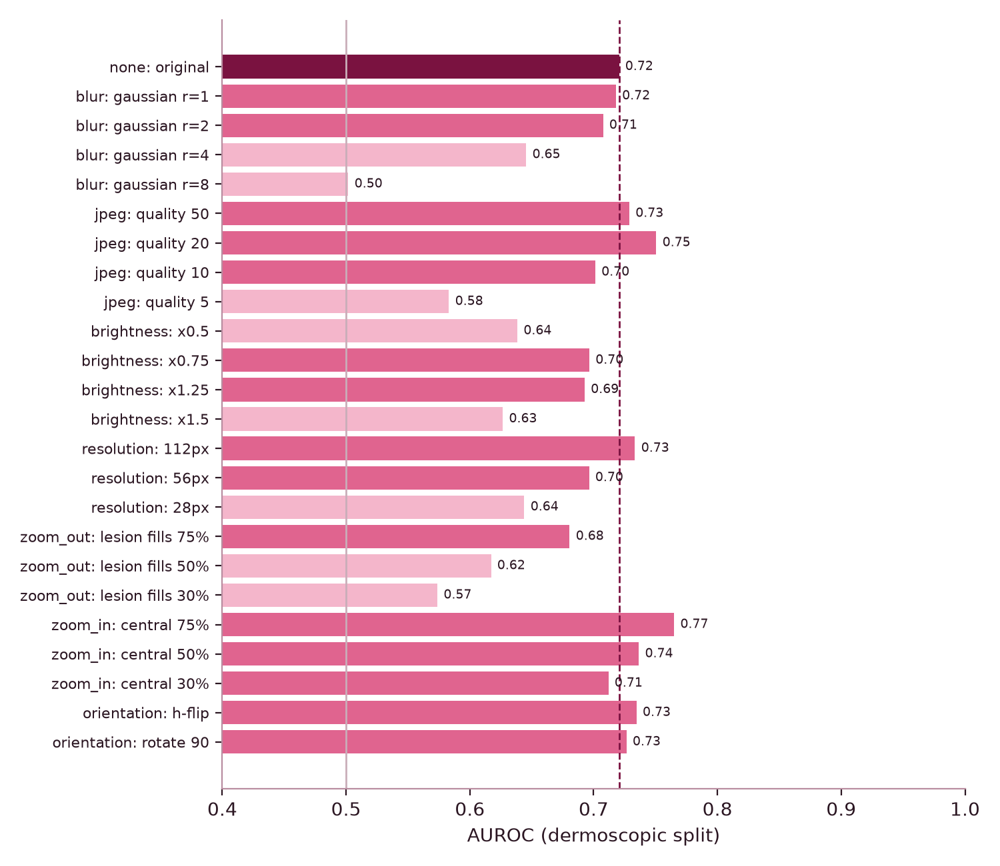

### **Live demo:** https://skinsight-weld.vercel.app
### **GitHub:** https://github.com/Ar2095/SkinsightAI
### **Demo video:** _coming soon_

Skinsight checks a photo of a skin spot and estimates whether it looks **benign or malignant**, and which of 11 lesion types it most resembles. It is a ResNet-18 with two output heads, trained on the ISIC Archive. It runs entirely in your browser: the photo never leaves your device.

We first built Skinsight in May 2025 as a Streamlit app ([original Devpost](https://devpost.com/software/skinsight-rpxbmw)). For this hackathon we added three things:

1. **A held-out evaluation.** We tested on 749 ISIC images added to the archive *after* the model was trained, so none of them can be in its training data. We report the metric, confidence intervals, baselines, subgroups, and the conditions where it breaks.
2. **A static web app on Vercel.** The model now runs in the browser through ONNX. We checked that it produces the same numbers as the PyTorch model we evaluated.
3. **Honest output.** Every result now says how often a score like it was actually cancer in our tests.

The model itself was not retrained. Every number below describes the same checkpoint the app runs.

---


Skin cancer is the most common cancer in the United States, and catching it early is what saves lives. Melanoma caught while still localized has a five-year survival rate above 99%. Once it has spread to distant organs, survival drops to 36%. Early detection is hard in practice, though:

- **Long waits.** A new dermatology appointment takes 36.5 days on average in the US, and some cities wait months.
- **No dermatologist nearby.** People in rural areas often have none within reach.
- **Time and money.** Many people skip a visit for a spot they aren't sure about.


**Who has this problem:** anyone looking at a mole and wondering whether it's worth an appointment. This is especially true for people who can't easily get to a dermatologist. Today their options are a printed ABCDE checklist (subjective), teledermatology (costly and slow), or consumer apps that often charge per scan.

---


1. **Upload** a close-up photo of a skin spot. You can also try one of the built-in ISIC samples, including one cancer that Skinsight misses.
2. **Crop** it with a square box. A live preview with a rule-of-thirds grid shows exactly what the model will see, next to example crops. The crop step matters: tighter crops raised AUROC in our robustness test, but re-cropping can also flip an individual answer.
3. **Get a result.** You see benign or malignant with the probability, the most likely lesion types, next steps written in plain language, and a "how much to trust this" note. That note quotes how often lesions with a similar score were actually cancer in our evaluation.

The page also has a **How accurate is it?** section. Its numbers are imported directly from `eval/results/metrics.json`, so the site can never drift from the evaluation.

---


### Data
We trained on images downloaded from the [ISIC Archive](https://www.isic-archive.com) in May 2025, about 78,000 labeled dermoscopic images. We grouped them into binary (benign/malignant) and 11 subtype folders taken from ISIC's diagnosis hierarchy (`diagnosis_1` / `diagnosis_2`), for example `malignant_melanocytic-proliferation` (melanoma) and `benign_epidermal-proliferations` (e.g. seborrheic keratosis).

### Model
[`skin-imaging.py`](skin-imaging.py) holds the training code:

- **Backbone:** torchvision ResNet-18, pretrained on ImageNet, with its classifier removed
- **Binary head:** Linear(512→128) → ReLU → Dropout(0.3) → Linear(128→1), trained with `BCEWithLogitsLoss`
- **Subtype head:** the same shape ending in 11 outputs, trained with `CrossEntropyLoss`. The two losses are summed.
- **Input:** 224×224, ImageNet normalization, random horizontal flip and ±10° rotation during training
- **Optimizer:** Adam (lr 1e-4), batch size 64, 10 epochs, random 80/20 split

The checkpoint is [`dual_head_skin_model.pth`](dual_head_skin_model.pth).

### App
- **Original (2025):** a Streamlit app, [`skin_classifier.py`](skin_classifier.py).
- **New (2026):** a static Vite site in [`web/`](web/), hosted on Vercel.
  - [`export_onnx.py`](export_onnx.py) converts the checkpoint to ONNX, with the sigmoid and softmax built into the graph.
  - The browser runs it with onnxruntime-web (WebAssembly).
  - Cropping uses Cropper.js.

The browser's own canvas resize uses a different filter from the Python pipeline. So we ported PIL's antialiased bilinear resampler to JavaScript ([`web/src/preprocess.js`](web/src/preprocess.js)). It reproduces PIL byte-for-byte. Each layer of the deployed app is checked against the evaluated model:

| Check | Script | Result |
|---|---|---|
| ONNX vs. PyTorch, all 749 test images | `export_onnx.py` | max \|ΔP\| 5e-6, 0 decisions changed |
| JS resize vs. PIL, 43 images | `eval/check_web_preprocess.py` | 0 differing bytes |
| Live site vs. PyTorch, same crop, through the real UI | `web/scripts/e2e_parity.py` | max \|ΔP\| 3e-7 |

---


### What we measured
**The task:** given a dermoscopic image of a lesion, say whether it is malignant.

**Primary metric:** AUROC. We also report sensitivity and specificity at the app's own decision rule (P(malignant) > 0.5), PPV/NPV, Brier score, and calibration. 95% confidence intervals come from 2,000 stratified bootstrap resamples. The subtype head is scored with top-1 and top-3 accuracy.

### How we measured it: a temporal hold-out
Our original 2025 validation split was a random 80/20 split with no fixed seed. So it can't be reproduced, and images of the same lesion or patient could land on both sides. Instead, [`eval/fetch_holdout.py`](eval/fetch_holdout.py) builds the test set like this:

- **New images only.** It queries the public ISIC API for every image *created after 2025-06-01*. The model was committed on 2025-05-20, so none of these can be in its training data.
- **Labeled lesions only.** It keeps images with a Benign or Malignant diagnosis.
- **One image per lesion.** It keeps one image per `lesion_id`, since some lesions are photographed repeatedly.
- **A capped benign sample.** The MEL-SELF trial contributes about 3,000 benign images, so it keeps a seeded random sample of 400.

That produces three test splits:

| Split | What it is | Malignant | Benign |
|---|---|---|---|
| **dermoscopic** (primary) | same imaging type as training | 41 | 557 |
| **rcm** | reflectance confocal microscopy tiles: a modality the model never saw | 107 | 26 |
| **clinical** | non-dermoscopic close-up photos | 11 | 7 |

The image IDs and labels are committed ([`eval/data/manifest.csv`](eval/data/manifest.csv)), so anyone can rebuild the exact set.

### Results


| Split | n (mal / ben) | AUROC [95% CI] | Sensitivity [95% CI] | Specificity [95% CI] | PPV | NPV |
|---|---|---|---|---|---|---|
| **dermoscopic** | 598 (41 / 557) | **0.721** [0.643–0.799] | **48.8%** [34.1–63.4] | **73.4%** [69.5–77.0] | 11.9% | 95.1% |
| rcm (out of distribution) | 133 (107 / 26) | 0.514 [0.486–0.542] | 100% | 0% | 80.5% | – |
| clinical close-ups | 18 (11 / 7) | 0.688 [0.390–0.922] | 54.5% | 71.4% | 75.0% | 50.0% |

**Comparison with baselines and a reference** (dermoscopic split):

| Method | Sensitivity | Specificity | AUROC |
|---|---|---|---|
| Skinsight, binary head, threshold 0.5 | 48.8% | 73.4% | 0.721 |
| Skinsight, subtype head (sum of the 4 malignant classes) | – | – | 0.722 |
| Always say "benign" | 0% | 100% | 0.5 |
| Refer everyone | 100% | 0% | 0.5 |
| 58 dermatologists reading dermoscopy images ([Haenssle et al., *Ann Oncol* 2018](https://doi.org/10.1093/annonc/mdy166)); different images, so context rather than a head-to-head | 86.6% | 71.3% | – |
| Our original 2025 random split (not reproducible, possible same-lesion leakage) | ~78% | ~94% | – |

**How often a score was actually cancer.** The app shows this next to each result:

| P(malignant) | Lesions | Actually malignant |
|---|---|---|
| 0.0–0.1 | 242 | 5 (2.1%) |
| 0.1–0.5 | 188 | 16 (8.5%) |
| 0.5–0.9 | 109 | 8 (7.3%) |
| 0.9–1.0 | 59 | 12 (20.3%) |

**Subtype head** (dermoscopic, n = 198 with a fine-grained label; only 5 of the 11 classes appear in the new data): top-1 accuracy is 46.5%, below the 75.8% majority-class baseline, while top-3 accuracy is 85.9%. In the confusion matrix, every class's most common prediction is itself, so the app's class ordering is correct.

<p align="center"> </p>

### What the results mean
- **Skinsight ranks lesions better than chance (AUROC 0.72), but it is not a screening tool.** At its default cut-off it misses about half of cancers (48.8% sensitivity). Dermatologists using dermoscopy catch about 87%.
- **Its 95% NPV mostly reflects how rare cancer is.** At this test set's 6.9% cancer rate, even "always benign" would be right 93% of the time. A "benign" result does not rule cancer out, and the app says so.
- **Moving the cut-off doesn't rescue it.** Thresholds chosen on the test set itself (so these are optimistic) give 57.8% specificity at 80% sensitivity, and 39.0% specificity at 90% sensitivity.
- **The probabilities are not calibrated** (ECE 0.25, Brier 0.21). Benign lesions average P(malignant) = 0.30. That's why the app reports the observed rate for each score range instead of the raw number.
- **Individual answers are unstable near the cut-off.** Mirroring the image changes 15.0% of benign/malignant decisions. Rotating it 90° changes 23.4%, and cropping to the central 75% changes 21.6%, even though AUROC barely moves. The melanoma photo in our demo video is called malignant (0.97) with the app's default crop, but benign (0.01) when cropped tightly around the lesion.
- **The 2025 numbers were optimistic.** The original random split reported 90.4% binary accuracy. On genuinely new images, accuracy is 71.7%, below the 93% you'd get from always saying "benign". This is the main finding of this submission.

### Where it stops being useful
Measured with [`eval/evaluate.py`](eval/evaluate.py) by degrading the dermoscopic split:

- **Not a skin-surface photo.** On confocal microscopy tiles the model outputs about 0.58 for nearly every image and calls all of them malignant (AUROC 0.51).
- **Blur:** AUROC holds up to a Gaussian radius of 2 px (at 224 px), drops to 0.65 at 4 px, and reaches chance (0.50) at 8 px.
- **Lighting:** ±50% brightness drops AUROC to 0.63–0.64.
- **Framing:** when the lesion fills only 50% or 30% of the crop, AUROC falls to 0.62 and 0.57. Cropping in tighter *helps*: the central 75% scores 0.77. That's why the app makes you crop.
- **Heavy compression:** JPEG quality 5 drops AUROC to 0.58. Quality 10–50 has no effect.
- **Darker skin is untested.** Only 234 test images carry a Fitzpatrick label: 220 are type I, and none are type IV–VI.

**Subgroups** (dermoscopic; small groups have wide intervals; full table in [`eval/results/results.md`](eval/results/results.md)):

| Subgroup | Malignant / Benign | AUROC |
|---|---|---|
| Biopsy-confirmed labels | 30 / 151 | 0.75 |
| Not biopsy-confirmed | 11 / 406 | 0.68 |
| Male | 17 / 257 | 0.83 |
| Female | 24 / 300 | 0.65 |
| Head and neck | 24 / 94 | 0.60 |
| Trunk | 5 / 196 | 0.78 |

Inference cost: 10 ms per image on a laptop CPU (PyTorch, batch of 1). The web app has no server, so serving costs nothing beyond static hosting.

---


**Who benefits**
- People who can't easily see a dermatologist. They get a free, private, immediate second look and a reminder of the warning signs (ABCDE) and when to book a visit.
- Students and the public, who can see a clear example of what a dermatology model can and can't do, with its evaluation published alongside it.

**Who could be harmed, and what we did about it**
- **People falsely reassured.** This is the biggest risk: Skinsight misses about half of cancers. A benign result never says "safe". The app shows the miss rate on every benign result and tells people to see a doctor about changing spots.
- **People sent to the doctor unnecessarily.** About 88% of malignant flags in our test were false alarms. That causes anxiety and wasted appointments. The result card quotes the real rate.
- **People with darker skin.** We could not measure performance for Fitzpatrick IV–VI at all, and dermatology datasets are known to under-represent them. The app lists this under "Don't trust it when".
- **Privacy.** Skin photos are sensitive. Inference runs on-device, and no image is uploaded or stored.
- **Misuse on the wrong images.** On non-dermoscopic or microscopy images, the output is meaningless. The app gives photo guidance and states the known failure modes.

---


- **Few positives.** Only 41 malignant lesions in the primary split, so sensitivity's 95% CI spans 34–63%.
- **Label quality varies.** 406 of the 557 benign labels are not biopsy-confirmed. Most are expert consensus on a single image, from the MEL-SELF trial.
- **Dermoscopic test, phone-photo use.** The test images are dermoscopic, but people will upload phone photos. Our only clinical-photo split has 18 images.
- **Same archive.** The temporal split rules out duplicate *images*. But it is still the ISIC Archive, and a patient photographed before June 2025 could reappear with a new image of a different lesion.
- **Subtype coverage.** Only 5 of the 11 subtype classes appear in the post-cutoff data, so 6 classes are untested.
- **Crop and orientation sensitivity.** A single result can flip with how the photo is framed or mirrored (15–34% of decisions in our tests). We have not yet added test-time averaging.
- **Unprincipled threshold.** The 0.5 cut-off was never tuned for sensitivity, and the scores are uncalibrated.
- **Indirect dermatologist comparison.** The dermatologist numbers come from a published study on different images.
- **Unrecoverable 2025 validation split.** It used no seed, so the original 90% figure can't be reproduced or audited.

---


- **Finding a dataset.** In 2025, many skin datasets we found were incomplete, synthetic, or too small. The ISIC Archive's diagnosis hierarchy gave us 11 consistent classes.
- **Choosing a model.** We tried several architectures and ensembles (`ensemble_predictions.py` in the history). We kept ResNet-18 because the alternatives were less accurate.
- **Finding a fair test set a year later.** The training split was lost. Then we noticed that ISIC's API pages images in creation order, which let us query only images added after the model existed.
- **Matching the browser to Python exactly.** Canvas resizing gave slightly different pixels, so we ported PIL's fixed-point resampler to JavaScript and tested it byte-for-byte.

---


- **A random split can flatter a model badly.** Ours did: 90% accuracy on a random split, versus 72% accuracy and 49% sensitivity on new images.
- **Accuracy is the wrong headline when 93% of lesions are benign.** Sensitivity, specificity and AUROC tell the real story.
- **A probability isn't a risk until it's calibrated.** A score of 0.97 here meant "about 1 in 5 chance of cancer".
- **Shipping the model is part of the evaluation.** If the deployed preprocessing differs from the evaluated one, the numbers no longer describe the product.

---


1. **Retrain properly:**
   - patient-level train/validation/test splits with a fixed seed
   - class weighting for the rare malignant classes
   - phone-photo-style augmentation (blur, lighting, framing)
2. **Stabilize single answers.** Average predictions over flips, rotations and several crops (test-time augmentation), and re-measure the decision-flip rate.
3. **Calibrate and choose the threshold for sensitivity.** Apply temperature scaling on a validation set, then pick the cut-off for about 90% sensitivity on validation, not test.
4. **Test on phone photos and diverse skin.** Evaluate externally on PAD-UFES-20 (smartphone images, excluded from training) and on skin-tone-labelled sets such as DDI and Fitzpatrick17k, reporting results by Fitzpatrick type.
5. **Add a reject option.** Detect out-of-distribution or low-quality photos and decline to answer instead of guessing.
6. **Run a small reader study.** Compare Skinsight against non-expert users with the ABCDE checklist on the same images, since that is the real alternative for our users.

---


**Team:** [Ar2095](https://github.com/Ar2095) and [vlww](https://github.com/vlww).

**Data**
- [ISIC Archive](https://www.isic-archive.com), International Skin Imaging Collaboration. Training images (May 2025) and test images (created after 2025-06-01) are each under their own CC-0 or CC-BY license. All test images are CC-BY, contributed by:
  - Memorial Sloan Kettering Cancer Center
  - the [MEL-SELF trial](https://www.sydney.edu.au/medicine-health/our-research/research-centres/melself-project.html), University of Sydney
  - Dr. Cristian Navarrete et al.
- The in-app sample images are ISIC_6537724, ISIC_3099700, ISIC_5423259 and ISIC_7168023 (CC-BY, from MSKCC and Navarrete et al.).

**Models and code we didn't write**
- [ResNet-18](https://arxiv.org/abs/1512.03385) (He et al., 2016), with ImageNet weights from [torchvision](https://pytorch.org/vision/)
- [PyTorch](https://pytorch.org), [scikit-learn](https://scikit-learn.org), [pandas](https://pandas.pydata.org), [Matplotlib](https://matplotlib.org), [Pillow](https://python-pillow.org)
- Pillow's bilinear resampler (`libImaging/Resample.c`, HPND license), ported to JavaScript in `web/src/preprocess.js`
- [ONNX Runtime Web](https://onnxruntime.ai) (MIT), [Cropper.js](https://fengyuanchen.github.io/cropperjs/) (MIT), [Vite](https://vite.dev) (MIT)
- [Streamlit](https://streamlit.io) and [streamlit-cropper](https://github.com/turner-anderson/streamlit-cropper) for the original app
- Fonts: Jost, Inter, Unbounded and Space Grotesk (Google Fonts, SIL OFL)

**Statistics cited**
- [Skin Cancer Foundation](https://www.skincancer.org/skin-cancer-information/skin-cancer-facts/) (1 in 5 Americans by age 70)
- [AMN Healthcare 2025 Survey of Physician Appointment Wait Times](https://www.amnhealthcare.com/siteassets/amn-insights/physician/ps-2025-physician-appt-wait-times---wp-v6.pdf) (36.5 days)
- [American Cancer Society](https://www.cancer.org/cancer/types/melanoma-skin-cancer/detection-diagnosis-staging/survival-rates-for-melanoma-skin-cancer-by-stage.html) (melanoma survival by stage)
- [Haenssle et al. 2018](https://doi.org/10.1093/annonc/mdy166) (dermatologist reference)

**AI tools:** Claude Code (Anthropic) helped build the 2026 additions: the hold-out evaluation scripts, the ONNX export, the web app port, the banners and this README. We reviewed every result and every number above against the scripts' output.

---

## Run it yourself

**Requirements:** Python 3.12 and Node 20+. Google Chrome is needed only for the optional browser checks.

```bash
git clone https://github.com/Ar2095/SkinsightAI.git
cd SkinsightAI
python3.12 -m venv .venv && source .venv/bin/activate   # Windows: .venv\Scripts\activate
pip install -r requirements.txt
```

### Reproduce the evaluation
```bash
python eval/fetch_holdout.py        # downloads the 749 test images listed in eval/data/manifest.csv (~420 MB)
python eval/evaluate.py             # ~2 min on a laptop CPU; writes eval/results/
```
This writes four things to `eval/results/`:
- `metrics.json` (every number in this README)
- `results.md` (all tables, including every subgroup)
- `predictions.csv` (per-image scores)
- `roc.png`, `calibration.png` and `robustness.png`

The run is deterministic. `fetch_holdout.py` uses the committed `eval/data/metadata_all.csv`. Pass `--refresh` to re-query the ISIC API, but note that the archive keeps growing, so that would change the test set.

### Check the deployed model against the evaluated one
```bash
python export_onnx.py                       # rebuilds web/public/model/skinsight.onnx and checks it against PyTorch
python eval/check_web_preprocess.py         # JS resize vs. PIL (needs Node)
cd web && npm ci && npm run build && npx vite preview --port 4173 &
cd .. && python web/scripts/e2e_parity.py   # drives the real UI in headless Chrome
```

### Run the web app
```bash
cd web
npm ci
npm run dev        # http://localhost:5173
```
To deploy, run `vercel deploy --prod` from the repo root. [`vercel.json`](vercel.json) builds `web/` and serves `web/dist`.

### Run the original 2025 Streamlit app
```bash
streamlit run skin_classifier.py
```

### Repository layout
```
skinsight_model.py        model definition, class names, preprocessing (shared by eval + export)
dual_head_skin_model.pth  trained checkpoint
skin-imaging.py           2025 training script
skin_classifier.py        2025 Streamlit app
export_onnx.py            PyTorch -> ONNX + parity check
eval/
  fetch_holdout.py        builds the post-cutoff ISIC test set
  evaluate.py             all metrics, bootstrap CIs, subgroups, robustness, figures
  check_web_preprocess.py JS vs PIL resize check
  data/                   metadata + manifest (images are downloaded, not committed)
  results/                metrics.json, results.md, predictions.csv, figures
web/                      Vite site deployed to Vercel (src/, public/model/, public/devpost/ banners)
```

---

*Skinsight is for educational and informational purposes only. It is not a substitute for professional medical advice, diagnosis, or treatment. If you have any concerns, please consult a certified dermatologist.*
